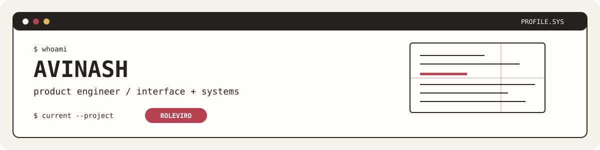

<picture>
  <source media="(prefers-color-scheme: dark)" srcset="./assets/profile-banner-legacy-dark.svg">
  <source media="(prefers-color-scheme: light)" srcset="./assets/profile-banner-legacy-light.svg">
  
</picture>

<p align="center">
  <a href="https://www.roleviro.com">[ ROLEVIRO ]</a>
  &nbsp; <a href="https://github.com/i-avi-nash?tab=repositories">[ REPOSITORIES ]</a>
</p>

<pre>
┌──────────────────────────────────────────────────────────────────────────────┐
│  AVINASH / PRODUCT ENGINEER                                      STATUS: ON   │
├──────────────────────────────────────────────────────────────────────────────┤
│  I build thoughtful software products: product interfaces, durable systems,  │
│  and browser experiences that earn the right to feel simple.                  │
└──────────────────────────────────────────────────────────────────────────────┘
</pre>

```text
  FOCUS       product engineering · interface design · durable systems
  EXPLORING   document generation · media pipelines · WebCodecs
  NOW         Roleviro — a modern resume builder
```

## [ FEATURED PRODUCT ]

<pre>
╭──────────────────────────────────────────────────────────────────────────────╮
│  ROLEVIRO                                                        LIVE PRODUCT │
│  ──────────────────────────────────────────────────────────────────────────  │
│  A modern resume builder for creating work that feels like you.               │
│                                                                              │
│  EDIT  ──►  LIVE PREVIEW  ──►  TEMPLATE  ──►  EXPORT                         │
│                                                                              │
│  React · TypeScript · Vite · Clerk · Neon · Drizzle · Vercel                 │
╰──────────────────────────────────────────────────────────────────────────────╯
</pre>

Roleviro brings responsive editing, an A4 live preview, document import, server-rendered PDF export, secure accounts, autosave, cloud persistence, and payments into one considered workflow.

<p>
  <a href="https://www.roleviro.com"><strong>Launch Roleviro ↗</strong></a>
</p>

